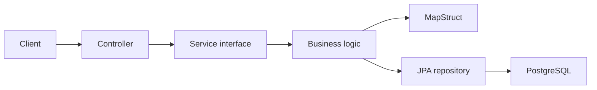

# Paperless DMS - SWEN3 Sprint 1

Minimal document-management REST API implementing the Sprint 1 requirements.

## Implemented

- Java 25 with Spring Boot 3.5
- document metadata CRUD REST API
- category management as the additional use case
- controller, service, repository and entity layers
- DTO mapping with MapStruct
- PostgreSQL persistence through Spring Data JPA/Hibernate
- validation, logging and basic exception handling
- unit tests with mocked repositories and JaCoCo coverage
- Docker Compose for API and PostgreSQL
- GitHub Actions CI

Actual PDF bytes, OCR, queues, MinIO, Elasticsearch, GenAI and the web UI are added in later sprints. Sprint 1 stores document metadata.

## Start

```bash
docker compose up --build
```

API: `http://localhost:8080`

## Test

```bash
./mvnw clean verify
```

Coverage report: `target/site/jacoco/index.html`

## REST endpoints

| Method | Path | Purpose |
| --- | --- | --- |
| POST | `/api/categories` | Create category |
| GET | `/api/categories` | List categories |
| POST | `/api/documents` | Create document metadata |
| GET | `/api/documents` | List documents |
| GET | `/api/documents/{id}` | Read one document |
| PUT | `/api/documents/{id}` | Update document |
| DELETE | `/api/documents/{id}` | Delete document |

Example:

```bash
curl -X POST http://localhost:8080/api/categories \
  -H 'Content-Type: application/json' \
  -d '{"name":"Invoices"}'

curl -X POST http://localhost:8080/api/documents \
  -H 'Content-Type: application/json' \
  -d '{"title":"Invoice","fileName":"invoice.pdf","contentType":"application/pdf","categoryId":1}'
```

## Validation and error responses

### Validation rules

| Request | Field | Rule |
| --- | --- | --- |
| POST/PUT `/api/documents` | `title` | required, not blank, max. 200 characters |
| POST/PUT `/api/documents` | `fileName` | required, not blank, max. 255 characters |
| POST/PUT `/api/documents` | `contentType` | required, not blank, max. 100 characters |
| POST/PUT `/api/documents` | `categoryId` | optional, must be an existing category |
| POST `/api/categories` | `name` | required, not blank, max. 80 characters |
| `/api/documents/{id}` | `id` | must be a number |

### HTTP 400 Bad Request

`400` means the request itself is wrong: the data breaks one of the rules above, or the
request cannot be read at all (broken JSON, an id like `abc`). Nothing is saved or changed.
Fix the request and send it again; repeating the same request will always fail.

`404` is returned when a document id or `categoryId` does not exist.

### Example: invalid request

Creating a document with an empty title and without `fileName`:

```bash
curl -i -X POST http://localhost:8080/api/documents \
  -H 'Content-Type: application/json' \
  -d '{"title":"","contentType":"application/pdf"}'
```

Response:

```http
HTTP/1.1 400
Content-Type: application/json

{
  "timestamp": "2026-10-15T20:42:16.747Z",
  "status": 400,
  "message": "Validation failed",
  "validationErrors": {
    "fileName": "must not be blank",
    "title": "must not be blank"
  }
}
```

`validationErrors` lists every invalid field with the reason (the order of the fields can
vary). For broken JSON or an id that is not a number, Spring Boot's default error body is
returned instead (`"error": "Bad Request"`, no `validationErrors`).

## Troubleshooting

**Port already in use** (`Bind for 0.0.0.0:8080 failed: port is already allocated`,
`Port 8080 was already in use`, or the same for `5432`)

- Another program uses the port, often an old container, a second copy of the app or a
  locally installed PostgreSQL.
- Find it: macOS/Linux `lsof -i :8080`, Windows `netstat -ano | findstr :8080`.
- Stop that program, or stop old containers with `docker compose down`.
- Or start with other host ports: `API_PORT=8081 DB_PORT=5433 docker compose up --build`
  (the API is then on `http://localhost:8081`).

**Docker problems**

- `Cannot connect to the Docker daemon` / `docker: command not found`: start Docker Desktop
  and wait until it is running.
- Code changes are not visible: rebuild with `docker compose up --build`.
- The API does not start: read its log with `docker compose logs api`.
- Database login fails after the credentials were changed: the old volume still has the old
  ones. `docker compose down -v` deletes the volume (**all stored data is lost**).

**`./mvnw: Permission denied`** (macOS/Linux): run `chmod +x mvnw` once.

## Architecture



Constructor injection and the `DocumentService` interface keep components loosely coupled. Unit tests mock the repositories, so they do not use the production database.

## Team workflow

1. Work starts from `develop`.
2. Every task has a GitHub issue and assignee.
3. Every member creates a `feature/...` branch.
4. Every member commits and pushes using their own GitHub account.
5. Changes enter `develop` through reviewed pull requests.
6. The sprint is released through a pull request from `develop` to `main`.
