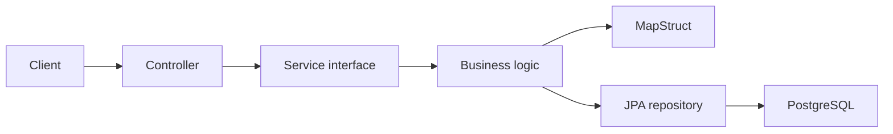

# Paperless DMS - SWEN3 Sprint 1

Minimal document-management REST API implementing the Sprint 1 requirements.

## Implemented

- Java 25 with Spring Boot 3.5
- document metadata CRUD REST API
- category management as the additional use case
- controller, service, repository and entity layers
- DTO mapping with MapStruct
- PostgreSQL persistence through Spring Data JPA/Hibernate
- validation, logging and basic exception handling
- unit tests with mocked repositories and JaCoCo coverage
- Docker Compose for API and PostgreSQL
- GitHub Actions CI

Actual PDF bytes, OCR, queues, MinIO, Elasticsearch, GenAI and the web UI are added in later sprints. Sprint 1 stores document metadata.

## Start

```bash
docker compose up --build
```

API: `http://localhost:8080`

## Test

```bash
./mvnw clean verify
```

Coverage report: `target/site/jacoco/index.html`

## REST endpoints

| Method | Path | Purpose |
| --- | --- | --- |
| POST | `/api/categories` | Create category |
| GET | `/api/categories` | List categories |
| POST | `/api/documents` | Create document metadata |
| GET | `/api/documents` | List documents |
| GET | `/api/documents/{id}` | Read one document |
| PUT | `/api/documents/{id}` | Update document |
| DELETE | `/api/documents/{id}` | Delete document |

Example:

```bash
curl -X POST http://localhost:8080/api/categories \
  -H 'Content-Type: application/json' \
  -d '{"name":"Invoices"}'

curl -X POST http://localhost:8080/api/documents \
  -H 'Content-Type: application/json' \
  -d '{"title":"Invoice","fileName":"invoice.pdf","contentType":"application/pdf","categoryId":1}'
```

## Architecture



Constructor injection and the `DocumentService` interface keep components loosely coupled. Unit tests mock the repositories, so they do not use the production database.

## Team workflow

1. Work starts from `develop`.
2. Every task has a GitHub issue and assignee.
3. Every member creates a `feature/...` branch.
4. Every member commits and pushes using their own GitHub account.
5. Changes enter `develop` through reviewed pull requests.
6. The sprint is released through a pull request from `develop` to `main`.
