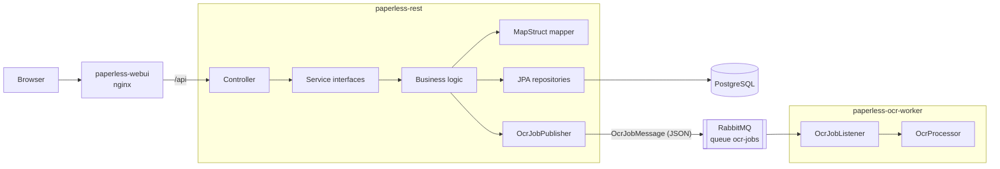

# Paperless DMS - SWEN3

Minimal document-management application implementing the Sprint 1, Sprint 2 and Sprint 3 requirements.

## Implemented

- Java 25 with Spring Boot 3.5
- document metadata CRUD REST API
- category management as the additional use case
- controller, service, repository and entity layers
- DTO mapping with MapStruct
- PostgreSQL persistence through Spring Data JPA/Hibernate
- validation, logging and basic exception handling
- unit tests with mocked repositories and JaCoCo coverage
- Docker Compose for API and PostgreSQL (`docker-compose.yaml`)
- responsive web UI with Bootstrap 5, served by nginx
- dashboard, document details and validated forms
- PDF upload from the web UI to the REST API (`multipart/form-data`)
- same-origin communication from nginx to the REST API
- Docker Compose frontend container on port 80
- RabbitMQ message queue: every upload sends an OCR job to the queue `ocr-jobs`
- separate OCR worker service that receives the jobs (OCR itself follows in Sprint 4)
- layer-specific exceptions (business, data access, messaging) mapped to HTTP status codes
- GitHub Actions CI for the REST API and the OCR worker

The OCR itself, MinIO, Elasticsearch and GenAI are added in later sprints. The uploaded PDF is checked and its
metadata (file name, type, size) is stored; storing the file content itself follows with MinIO.

## Project structure

```text
.
├── docker-compose.yaml     # starts database, RabbitMQ, REST API, OCR worker and web UI
├── paperless-rest/         # Spring Boot REST API (Maven project, Dockerfile)
├── paperless-ocr-worker/   # Spring Boot OCR worker, listens on the RabbitMQ queue
├── paperless-webui/        # nginx + static web UI (HTML, Bootstrap 5, JavaScript)
└── docs/                   # sprint checklists
```

## Start

```bash
docker compose up --build
```

Frontend: `http://localhost/`

API (direct access): `http://localhost:8080`

RabbitMQ management UI: `http://localhost:15672` (user `paperless`, password `paperless`)

### Check the queue (Sprint 3)

1. Upload a PDF in the web UI (or with the `curl` example below).
2. Show the worker log:

   ```bash
   docker compose logs ocr-worker
   ```

   It contains `OCR job received: documentId=... fileName=...`.
3. In the RabbitMQ UI, the queue `ocr-jobs` is listed under *Queues* with one consumer.

The nginx frontend forwards browser requests from `/api/...` to the API container. No separate frontend development server is required.

## Web UI

- Dashboard with document and category counts
- document list with links to detail pages
- form for uploading a PDF document (title, file, optional category)
- form for creating categories
- client-side validation: title and file required, only `.pdf`, max. 10 MB
- server error messages displayed in the page

Quick check:

1. Open `http://localhost/`.
2. Create a category.
3. Upload a PDF, enter a title and select the category.
4. Open the document from the list to view its detail page.

## Test

```bash
cd paperless-rest && ./mvnw clean verify
cd ../paperless-ocr-worker && ./mvnw clean verify
```

Coverage reports: `paperless-rest/target/site/jacoco/index.html` and
`paperless-ocr-worker/target/site/jacoco/index.html`

The tests need neither PostgreSQL nor RabbitMQ (see [Testing strategy](#testing-strategy)).

## REST endpoints

| Method | Path | Purpose |
| --- | --- | --- |
| POST | `/api/categories` | Create category |
| GET | `/api/categories` | List categories |
| POST | `/api/documents` | Upload a PDF (`multipart/form-data`: `file`, `title`, optional `categoryId`) |
| GET | `/api/documents` | List documents |
| GET | `/api/documents/{id}` | Read one document |
| PUT | `/api/documents/{id}` | Update document metadata (JSON) |
| DELETE | `/api/documents/{id}` | Delete document |

Example:

```bash
curl -X POST http://localhost:8080/api/categories \
  -H 'Content-Type: application/json' \
  -d '{"name":"Invoices"}'

curl -X POST http://localhost:8080/api/documents \
  -F file=@invoice.pdf \
  -F title=Invoice \
  -F categoryId=1
```

## Validation and error responses

### Validation rules

| Request | Field | Rule |
| --- | --- | --- |
| POST `/api/documents` | `file` | required, not empty, must be a PDF (starts with `%PDF-`), max. 10 MB |
| POST/PUT `/api/documents` | `title` | required, not blank, max. 200 characters |
| PUT `/api/documents/{id}` | `fileName` | required, not blank, max. 255 characters |
| PUT `/api/documents/{id}` | `contentType` | required, not blank, max. 100 characters |
| POST/PUT `/api/documents` | `categoryId` | optional, positive, must be an existing category |
| POST `/api/categories` | `name` | required, not blank, max. 80 characters |
| `/api/documents/{id}` | `id` | must be a number |

### HTTP 400 Bad Request

`400` means the request itself is wrong: the data breaks one of the rules above, or the
request cannot be read at all (broken JSON, an id like `abc`). Nothing is saved or changed.
Fix the request and send it again; repeating the same request will always fail.

### Other error codes

| Status | When | Thrown in |
| --- | --- | --- |
| `404` | document id or `categoryId` does not exist | business layer (`NotFoundException`) |
| `409` | a category with this name already exists (case-insensitive) | business layer (`ConflictException`) |
| `413` | uploaded file is larger than 10 MB | Spring multipart limit |
| `503` | RabbitMQ is not reachable; the upload is rolled back, nothing is saved | messaging layer (`QueuePublishException`) |
| `503` | the database is not reachable | data access layer (`DataAccessException`) |

All errors are translated in one place, `shared/GlobalExceptionHandler`, so controllers and services contain no HTTP
error handling.

### Example: invalid request

Updating a document with an empty title and without `fileName`:

```bash
curl -i -X PUT http://localhost:8080/api/documents/1 \
  -H 'Content-Type: application/json' \
  -d '{"title":"","contentType":"application/pdf"}'
```

Response:

```http
HTTP/1.1 400
Content-Type: application/json

{
  "timestamp": "2026-10-15T20:42:16.747Z",
  "status": 400,
  "message": "Validation failed",
  "validationErrors": {
    "fileName": "must not be blank",
    "title": "must not be blank"
  }
}
```

`validationErrors` lists every invalid field with the reason (the order of the fields can
vary). For broken JSON or an id that is not a number, Spring Boot's default error body is
returned instead (`"error": "Bad Request"`, no `validationErrors`).

## Troubleshooting

**Port already in use** (`Bind for 0.0.0.0:8080 failed: port is already allocated`,
`Port 8080 was already in use`, or the same for `5432`)

- Another program uses the port, often an old container, a second copy of the app or a
  locally installed PostgreSQL.
- Find it: macOS/Linux `lsof -i :8080`, Windows `netstat -ano | findstr :8080`.
- Stop that program, or stop old containers with `docker compose down`.
- Or start with other host ports: `API_PORT=8081 DB_PORT=5433 docker compose up --build`
  (the API is then on `http://localhost:8081`).

**Docker problems**

- `Cannot connect to the Docker daemon` / `docker: command not found`: start Docker Desktop
  and wait until it is running.
- Code changes are not visible: rebuild with `docker compose up --build`.
- The API does not start: read its log with `docker compose logs api`.
- Database login fails after the credentials were changed: the old volume still has the old
  ones. `docker compose down -v` deletes the volume (**all stored data is lost**).

**`./mvnw: Permission denied`** (macOS/Linux): run `chmod +x paperless-rest/mvnw paperless-ocr-worker/mvnw` once.

**Upload returns 503**: RabbitMQ is not running or not healthy yet. Check with `docker compose ps` and
`docker compose logs rabbitmq`, wait until it is `healthy`, then upload again.

## Architecture



Upload flow:

1. The web UI sends the PDF as `multipart/form-data` to `POST /api/documents` (through nginx).
2. `DocumentController` validates the form fields and passes them to `DocumentService`.
3. `DocumentServiceImpl` checks the file (not empty, PDF signature), saves the metadata and sends an
   `OcrJobMessage` through the `OcrJobPublisher` interface.
4. `RabbitOcrJobPublisher` sends the message as JSON to the queue `ocr-jobs`.
5. The OCR worker receives the message in `OcrJobListener` and passes it to `OcrProcessor`. For Sprint 3 the
   processor only logs the job; the real OCR follows in Sprint 4.

Layers in `paperless-rest`: controller (REST, DTOs) → service interface → business logic → repository / messaging.
Each layer only knows the layer below it, and only through interfaces injected via the constructor.

## Design decisions

Short architecture decision records (context → decision → consequence).

| # | Decision | Why | Consequence |
| --- | --- | --- | --- |
| 1 | nginx serves the web UI and proxies `/api` to the REST service | browser sees one origin, no CORS setup; frontend and backend are separate containers | the API URL in the UI is relative (`/api`) |
| 2 | Bootstrap 5 for the web UI, stored in the repository | lecturer feedback (use a framework); works offline and in CI | no build step for the UI |
| 3 | Upload as `multipart/form-data` with a PDF signature check (`%PDF-`) | the file itself must reach the REST service; the file extension alone can be faked | 400 for non-PDF files, 413 above 10 MB |
| 4 | `OcrJobPublisher` interface between business logic and RabbitMQ | loose coupling: the service does not depend on RabbitMQ classes and can be unit-tested with a mock | another broker only needs a new implementation |
| 5 | The message is sent inside the upload transaction | if RabbitMQ is down, the exception rolls the database insert back; no document stays without an OCR job | the user gets 503 and can retry; connection timeout is 5 s |
| 6 | Messages are JSON (`Jackson2JsonMessageConverter`), the worker has its own `OcrJobMessage` record | readable in the RabbitMQ UI, no shared Java library between the services | both records must keep the same field names |
| 7 | Invalid messages are rejected without requeue (`InvalidOcrJobException`) | a broken message would otherwise be redelivered forever | broken messages are logged and dropped |
| 8 | One `GlobalExceptionHandler` maps layer exceptions to HTTP codes | consistent error bodies, no `try/catch` in controllers | new exception types need one handler method |

## Testing strategy

- **Unit tests for the business logic** (`DocumentServiceImplTest`, `CategoryServiceImplTest`): repositories, mapper
  and `OcrJobPublisher` are Mockito mocks. They cover the normal case and the error cases (invalid file, unknown
  category, duplicate name, queue not available).
- **Web layer tests** (`@WebMvcTest`, `DocumentUploadWebTest`, `CategoryControllerTest`): test HTTP status codes and
  JSON bodies with MockMvc; the service is mocked.
- **Exception mapping** (`GlobalExceptionHandlerTest`): every exception type returns the expected status code.
- **Messaging** (`RabbitOcrJobPublisherTest`, `OcrJobListenerTest`, `OcrJobMessageConversionTest`): the publisher
  sends to the right queue and translates broker errors; the worker converts the JSON from the REST service and
  rejects invalid jobs.
- No test needs a running database or RabbitMQ, so `./mvnw clean verify` runs anywhere, also in CI.
- Coverage is measured with JaCoCo (target: more than 70 % line coverage).
- **Manual end-to-end check** with `docker compose up --build`: upload a PDF in the web UI, check the worker log,
  stop RabbitMQ (`docker compose stop rabbitmq`) and check that the upload returns 503.

## Lessons learned

- **Small pull requests are easier to review.** Moving folders and changing code in one PR made the diff hard to
  read; `git mv` keeps the history and GitHub shows the files as renamed.
- **Validate on both sides.** Browser validation is for the user; the server must validate again because the
  browser can be bypassed (e.g. with `curl`).
- **Default limits matter.** nginx accepts only 1 MB request bodies by default, so uploads failed until
  `client_max_body_size` was set.
- **Plan for the broker being down.** Without a connection timeout the upload waited 60 s and nginx returned 504;
  with a 5 s timeout and a transaction rollback the user gets a clear 503.
- **Interfaces make testing easy.** Because the service only knows `OcrJobPublisher`, the queue can be mocked in unit
  tests and no RabbitMQ is needed in CI.
- **Keep `main` stable.** Work happens on feature branches and `develop`; `main` is only updated through a
  reviewed pull request, because it is built and graded after each deadline.

## Team workflow

1. Work starts from `develop`.
2. Every task has a GitHub issue and assignee.
3. Every member creates a `feature/...` branch.
4. Every member commits and pushes using their own GitHub account.
5. Changes enter `develop` through reviewed pull requests.
6. The sprint is released through a pull request from `develop` to `main`.
