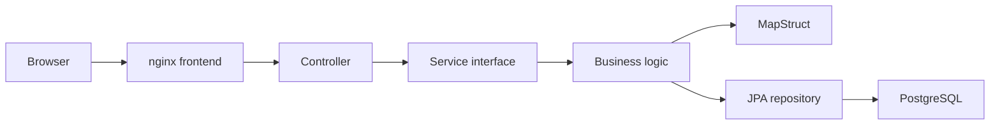

# Paperless DMS - SWEN3

Minimal document-management application implementing the Sprint 1 and Sprint 2 requirements.

## Implemented

- Java 25 with Spring Boot 3.5
- document metadata CRUD REST API
- category management as the additional use case
- controller, service, repository and entity layers
- DTO mapping with MapStruct
- PostgreSQL persistence through Spring Data JPA/Hibernate
- validation, logging and basic exception handling
- unit tests with mocked repositories and JaCoCo coverage
- Docker Compose for API and PostgreSQL (`docker-compose.yaml`)
- responsive web UI served by nginx
- dashboard, document details and validated forms
- PDF upload from the web UI to the REST API (`multipart/form-data`)
- same-origin communication from nginx to the REST API
- Docker Compose frontend container on port 80
- GitHub Actions CI

OCR, queues, MinIO, Elasticsearch and GenAI are added in later sprints. The uploaded PDF is checked and its
metadata (file name, type, size) is stored; storing the file content itself follows with MinIO.

## Project structure

```text
.
├── docker-compose.yaml     # starts database, REST API and web UI
├── paperless-rest/         # Spring Boot REST API (Maven project, Dockerfile)
├── paperless-webui/        # nginx + static web UI (HTML, CSS, JavaScript)
└── docs/                   # sprint checklists
```

## Start

```bash
docker compose up --build
```

Frontend: `http://localhost/`

API (direct access): `http://localhost:8080`

The nginx frontend forwards browser requests from `/api/...` to the API container. No separate frontend development server is required.

## Web UI

- Dashboard with document and category counts
- document list with links to detail pages
- form for uploading a PDF document (title, file, optional category)
- form for creating categories
- client-side validation: title and file required, only `.pdf`, max. 10 MB
- server error messages displayed in the page

Quick check:

1. Open `http://localhost/`.
2. Create a category.
3. Upload a PDF, enter a title and select the category.
4. Open the document from the list to view its detail page.

## Test

```bash
cd paperless-rest
./mvnw clean verify
```

Coverage report: `paperless-rest/target/site/jacoco/index.html`

## REST endpoints

| Method | Path | Purpose |
| --- | --- | --- |
| POST | `/api/categories` | Create category |
| GET | `/api/categories` | List categories |
| POST | `/api/documents` | Upload a PDF (`multipart/form-data`: `file`, `title`, optional `categoryId`) |
| GET | `/api/documents` | List documents |
| GET | `/api/documents/{id}` | Read one document |
| PUT | `/api/documents/{id}` | Update document metadata (JSON) |
| DELETE | `/api/documents/{id}` | Delete document |

Example:

```bash
curl -X POST http://localhost:8080/api/categories \
  -H 'Content-Type: application/json' \
  -d '{"name":"Invoices"}'

curl -X POST http://localhost:8080/api/documents \
  -F file=@invoice.pdf \
  -F title=Invoice \
  -F categoryId=1
```

## Validation and error responses

### Validation rules

| Request | Field | Rule |
| --- | --- | --- |
| POST `/api/documents` | `file` | required, not empty, must be a PDF (starts with `%PDF-`), max. 10 MB |
| POST/PUT `/api/documents` | `title` | required, not blank, max. 200 characters |
| PUT `/api/documents/{id}` | `fileName` | required, not blank, max. 255 characters |
| PUT `/api/documents/{id}` | `contentType` | required, not blank, max. 100 characters |
| POST/PUT `/api/documents` | `categoryId` | optional, positive, must be an existing category |
| POST `/api/categories` | `name` | required, not blank, max. 80 characters |
| `/api/documents/{id}` | `id` | must be a number |

### HTTP 400 Bad Request

`400` means the request itself is wrong: the data breaks one of the rules above, or the
request cannot be read at all (broken JSON, an id like `abc`). Nothing is saved or changed.
Fix the request and send it again; repeating the same request will always fail.

`404` is returned when a document id or `categoryId` does not exist.
`413` is returned when the uploaded file is larger than 10 MB.

### Example: invalid request

Updating a document with an empty title and without `fileName`:

```bash
curl -i -X PUT http://localhost:8080/api/documents/1 \
  -H 'Content-Type: application/json' \
  -d '{"title":"","contentType":"application/pdf"}'
```

Response:

```http
HTTP/1.1 400
Content-Type: application/json

{
  "timestamp": "2026-10-15T20:42:16.747Z",
  "status": 400,
  "message": "Validation failed",
  "validationErrors": {
    "fileName": "must not be blank",
    "title": "must not be blank"
  }
}
```

`validationErrors` lists every invalid field with the reason (the order of the fields can
vary). For broken JSON or an id that is not a number, Spring Boot's default error body is
returned instead (`"error": "Bad Request"`, no `validationErrors`).

## Troubleshooting

**Port already in use** (`Bind for 0.0.0.0:8080 failed: port is already allocated`,
`Port 8080 was already in use`, or the same for `5432`)

- Another program uses the port, often an old container, a second copy of the app or a
  locally installed PostgreSQL.
- Find it: macOS/Linux `lsof -i :8080`, Windows `netstat -ano | findstr :8080`.
- Stop that program, or stop old containers with `docker compose down`.
- Or start with other host ports: `API_PORT=8081 DB_PORT=5433 docker compose up --build`
  (the API is then on `http://localhost:8081`).

**Docker problems**

- `Cannot connect to the Docker daemon` / `docker: command not found`: start Docker Desktop
  and wait until it is running.
- Code changes are not visible: rebuild with `docker compose up --build`.
- The API does not start: read its log with `docker compose logs api`.
- Database login fails after the credentials were changed: the old volume still has the old
  ones. `docker compose down -v` deletes the volume (**all stored data is lost**).

**`./mvnw: Permission denied`** (macOS/Linux): run `chmod +x paperless-rest/mvnw` once.

## Architecture



nginx serves the static HTML, CSS and JavaScript and proxies `/api` requests to Spring Boot. The browser therefore uses one origin at `http://localhost/`.

Constructor injection and the `DocumentService` interface keep components loosely coupled. Unit tests mock the repositories, so they do not use the production database.

## Team workflow

1. Work starts from `develop`.
2. Every task has a GitHub issue and assignee.
3. Every member creates a `feature/...` branch.
4. Every member commits and pushes using their own GitHub account.
5. Changes enter `develop` through reviewed pull requests.
6. The sprint is released through a pull request from `develop` to `main`.
